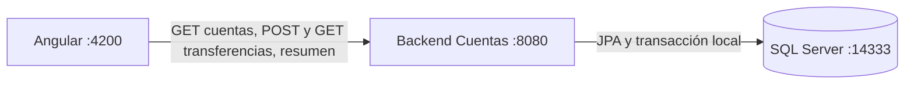

# EvaluacionJohnFarez

Sistema de cuentas y transferencias para la evaluación NETBY / Jardín Azuayo, basado en  «Reto Técnico Perfil Full Stack Mid Senior (Quarkus + Angular)». Aplicación de evaluación local, no habilitada para operaciones bancarias productivas.

## Arquitectura y tecnologías



- **Backend (Cuentas)**: API REST única. Dueño de SQL Server, cuentas, transferencias y rechazos. Ejecuta las reglas financieras y todas las consultas bajo `@Transactional`.
- **Frontend**: dashboard y formulario reales; proxy `/api` en desarrollo. Cada proyecto compila independientemente.

Java 25 (bytecode `release 25`), Quarkus 3.40.1, Maven Wrapper 3.9.12, Panache, MapStruct 1.6.3, Jakarta Validation, Flyway y SmallRye OpenAPI. SQL Server 2022 CU20 Developer. JUnit 5 (JUnit Platform) administrado por el BOM de Quarkus. Angular 21, PrimeNG 21.1.10, Aura 2.0.3, PrimeIcons 7, TypeScript y Reactive Forms. Versiones npm resueltas en package-lock.json; entorno evaluado Node.js 24.19.0 / npm 11.17.0.

## Inicio reproducible (Windows PowerShell)

Requisitos: Java 25, Docker con Compose, Node.js/npm, acceso a Maven Central/npm para la primera descarga. No hace falta Maven ni Angular CLI global. Usar una terminal por aplicación.

1. **SQL Server**: seguir [configuración de Cuentas](EvaluacionJohnFarez-Cuentas/README.md#sql-server). Crear configuración local con contraseñas propias, revisar memoria/puerto e iniciar SQL. El bootstrap de instalación nueva crea las bases principal y de pruebas; no borra datos.
2. **Cuentas**, desde su directorio:

```powershell
$env:JAVA_HOME='C:\Program Files\Eclipse Adoptium\jdk-25.0.4.101-hotspot' # JDK 25; ajustar a la instalación local
$env:PATH="$env:JAVA_HOME\bin;$env:PATH"
java -version
.\mvnw.cmd -version
$env:TEST_DB_NAME='evaluacion_john_farez_test'
.\mvnw.cmd -B -ntp verify
java -jar target/quarkus-app/quarkus-run.jar
```

3. **Angular**, desde Frontend y en otra terminal:

```powershell
node --version
npm.cmd --version
npm.cmd ci
npm.cmd start
```

Abrir http://localhost:4200. Sin cuentas registradas, el dashboard estará vacío; crearlas por la API. Cuentas carga la configuración local desde su directorio de trabajo. **TEST_DB_NAME solo selecciona la base de pruebas**. Para ejecutar el JAR de demostración sin escribir en la principal, establecer `$env:DB_NAME='evaluacion_john_farez_test'` antes de arrancarlo.

## JDK 25 consistente en terminal, Maven y VS Code

El proyecto genera bytecode Java 25: no se puede ejecutar con Java 17 o 21.
La configuraci?n `.vscode/settings.json` usa el JDK Temurin 25 instalado en este equipo
para el proyecto y las nuevas terminales integradas. En otro equipo, ajustar la ruta
`java.configuration.runtimes` y `terminal.integrated.env.windows` a su JDK 25.
Despu?s de cambiarla, abrir una terminal nueva y comprobar `java -version`,
`javac -version` y `mvnw.cmd -version` desde Cuentas: deben usar el mismo JDK 25.
No se modifican variables globales de Windows. Para terminales externas, establecer
`JAVA_HOME` y anteponer su carpeta `bin` al `PATH` como en el ejemplo de inicio.
Los scripts Python de verificaci?n requieren `JAVA_HOME`, validan Java 25 y una
`TEST_DB_NAME` aislada antes de arrancar procesos; no recurren a Java 17.

## Entorno completo con Docker Compose (un solo comando)

Alternativa al inicio manual: `compose.full.yaml` levanta base de datos + backend + frontend. Los dos Dockerfiles son multi-stage, así que compilan el JAR de Quarkus y el bundle de Angular dentro de las imágenes; no hace falta compilar antes en el host.

```bash
# Requiere el archivo EvaluacionJohnFarez-Cuentas/.env con las contraseñas (ver README de Cuentas).
docker compose -f compose.full.yaml --env-file EvaluacionJohnFarez-Cuentas/.env up -d --build
```

El entorno completo utiliza un volumen propio del proyecto `evaluacion-john-farez-full`.
Su SQL Server se publica en **14334**, independiente del SQL existente en **14333**;
no comparte ni migra el volumen de la instalaci?n local. El backend del contenedor
se conecta a `sqlserver:1433`, no al puerto publicado de Windows.
Para ejecutar solo el backend local, reutilizar SQL en 14333 y seguir el inicio manual.
No ejecutar el bootstrap de una instalaci?n nueva sobre bases existentes sin revisar su configuraci?n.

Si ya est?n ocupados 8080 o 4200, usar puertos separados sin detener otras aplicaciones:

```powershell
$env:FULL_SQLSERVER_PORT='14334'
$env:FULL_BACKEND_PORT='18080'
$env:FULL_FRONTEND_PORT='14200'
docker compose -f compose.full.yaml --env-file EvaluacionJohnFarez-Cuentas/.env up -d --build
```

En ese caso abrir http://localhost:14200 y Swagger en http://localhost:18080/q/swagger-ui/.
Estas variables solo cambian los puertos del entorno completo; `SQLSERVER_PORT`
sigue configurando la conexi?n del backend local. Conservar las contrase?as del volumen existente.

Servicios y acceso:

| Servicio | Contenedor | Acceso |
|---|---|---|
| SQL Server 2022 | sqlserver | 127.0.0.1:14334 |
| Bootstrap de BD (crea bases/usuario y termina) | db-init | — |
| Backend Quarkus (Cuentas) | backend | http://localhost:8080 (Swagger en /q/swagger-ui/) |
| Frontend Angular + nginx | frontend | http://localhost:4200 |

El arranque está encadenado: `db-init` corre tras SQL Server `healthy`, el `backend` espera a que el bootstrap termine, y el `frontend` (nginx) sirve los estáticos y hace de reverse proxy de `/api` hacia el backend. Detener este entorno conservando datos: `docker compose -f compose.full.yaml --env-file EvaluacionJohnFarez-Cuentas/.env down`. No usar `down -v` para una parada normal. El `compose.yaml` dentro de `EvaluacionJohnFarez-Cuentas` sigue disponible para levantar únicamente la base.

## Los diez criterios

| Criterio del PDF | Implementación |
|---|---|
| CA-01 Registro/listado | POST y GET cuentas; validaciones y unicidad SQL |
| CA-02 Transferencias | Validación, saldos y registro atómicos en Cuentas |
| CA-03 Sospechosas | Monto >5000 o sexta ejecutada en una hora; en_revision mueve dinero |
| CA-04 Límite diario | Máximo 10000 por origen/día; 422 con disponible |
| CA-05 Historial/resumen | Filtros combinables, fecha e ID descendentes; resumen actual |
| CA-06 Dashboard | Tabla real, estados, USD y orden exacto por saldo |
| CA-07 Formulario | Validación, POST real, confirmación y recuperación idempotente |
| CA-08 Capas | Resources, Services, Repositories, Entities, DTOs y mappers |
| CA-09 Buenas prácticas | CDI, validación, errores centralizados, DTOs y precisión; auditado/corregido |
| CA-10 Documentación | OpenAPI anotado, ejemplos y tres README reproducibles |

## Extras de bonificación

| Extra del PDF | Estado | Dónde |
|---|---|---|
| Docker / Docker Compose (entorno completo) | Implementado | `compose.full.yaml` levanta BD + backend + frontend; Dockerfiles multi-stage en cada proyecto |
| Pruebas unitarias (JUnit 5 + Mockito) | Implementado | `ReglasTransferenciaTest` (reglas de negocio) y Mockito (`@InjectMock`, `@InjectSpy`) |
| Pruebas de integración (`@QuarkusTest` contra BD) | Implementado | 6 clases `@QuarkusTest` contra SQL Server real |
| Paginación en listados | Implementado | `GET /api/cuentas` y `GET /api/transferencias` con page/size y `X-Total-Count` |
| DTOs y Mappers (MapStruct) | Implementado | `CuentaMapper`/`TransferenciaMapper` y DTOs separados de las entidades |
| Logs estructurados en operaciones críticas | Implementado | `TransferenciaOperacion` (solicitud, rechazo, detección sospechosa y ejecución) y `ApiExceptionMapper` |
| Manejo de CORS | Implementado | `quarkus.http.cors.enabled` para GET/POST/OPTIONS desde el frontend Angular |

## Integridad y decisiones

`TransferenciaOperacion.decidir` mantiene débito, crédito y registro bajo una transacción local `@Transactional`. Bloqueo por clave (`sp_getapplock`) y bloqueos pesimistas de cuentas por ID ascendente evitan doble consumo. Acumulados y frecuencia se calculan bajo esos bloqueos. No hay HTTP dentro de la transacción financiera. Fallos técnicos hacen rollback completo.

Rechazos por cuenta inactiva, saldo insuficiente, desbordamiento de destino o límite se registran sin tocar saldos; 422 se entrega después de confirmar el rechazo. Misma clave reproduce el error persistido. Cuerpos inválidos, cuentas iguales o inexistentes no crean rechazo persistido. Rechazos no consumen límite ni frecuencia. Un resultado técnico desconocido nunca se convierte en rechazo definitivo.

Día de negocio: America/Guayaquil; UTC en persistencia. Resumen y contador de sospechosas: movimientos de salida del día actual. Son interpretaciones documentadas porque el PDF no fija zona ni período de sospechosas. No existe aprobación manual: en_revision ya ejecutó el movimiento.


